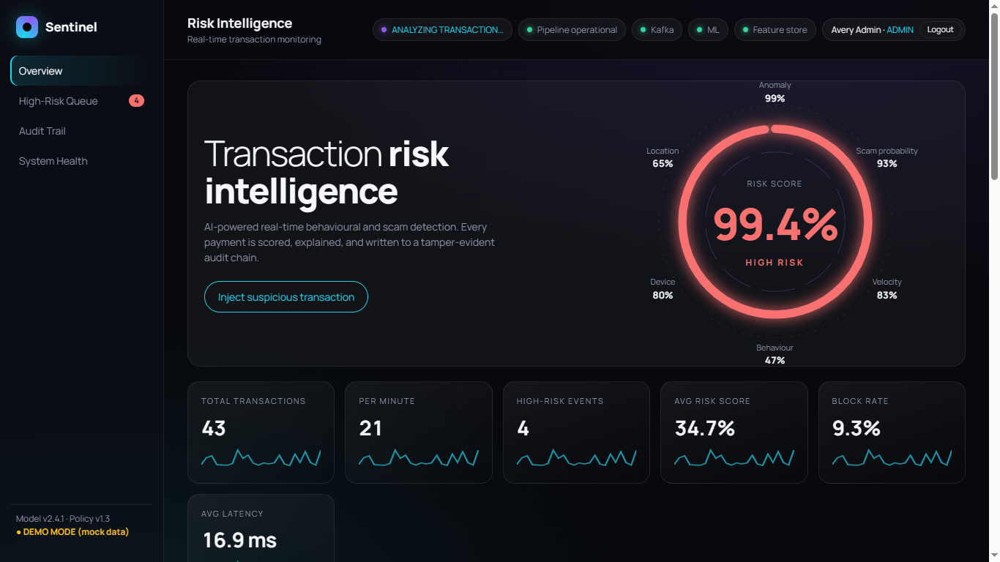

# Sentinel – Project Overview

Sentinel is a real-time, AI-assisted financial transaction risk platform. Every transaction is validated, enriched with behavioural features, checked against configurable rules, scored by an Isolation Forest (anomaly) and XGBoost (scam probability), combined by a SymPy risk formula, mapped to a versioned policy band, and written to a tamper-evident audit chain.

| Area | Where to look |
|------|---------------|
| Implemented modules | [MODULES.md](MODULES.md) |
| Libraries & dependencies | [DEPENDENCIES.md](DEPENDENCIES.md) |
| Screenshots | [SCREENSHOTS.md](SCREENSHOTS.md) |
| Database | [DATABASE_GUIDE.md](DATABASE_GUIDE.md) |
| How to run | root `README.md` |

