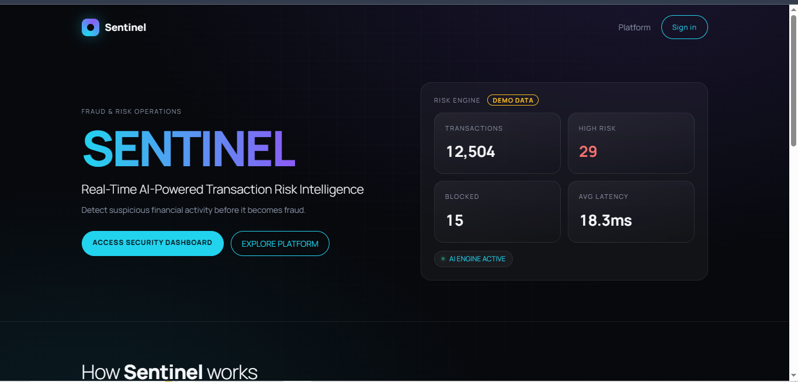
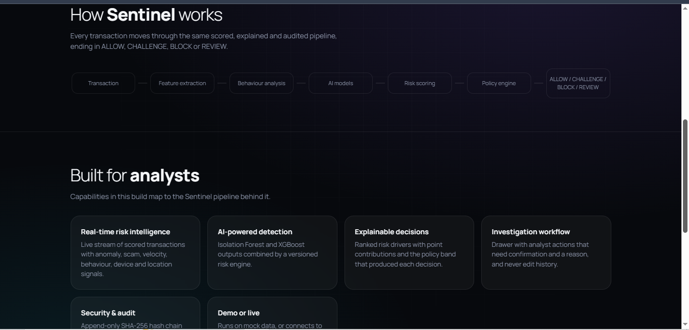
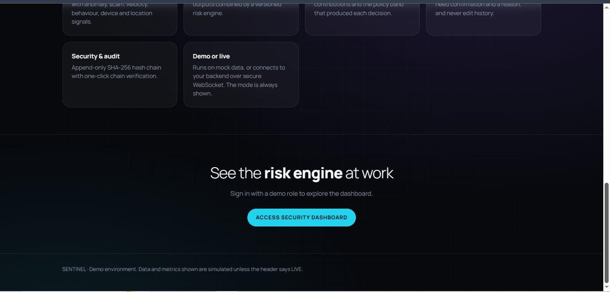
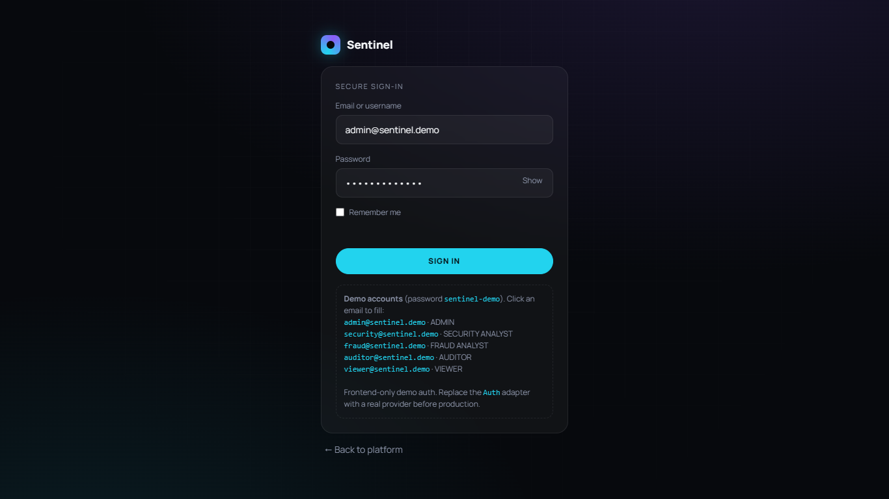
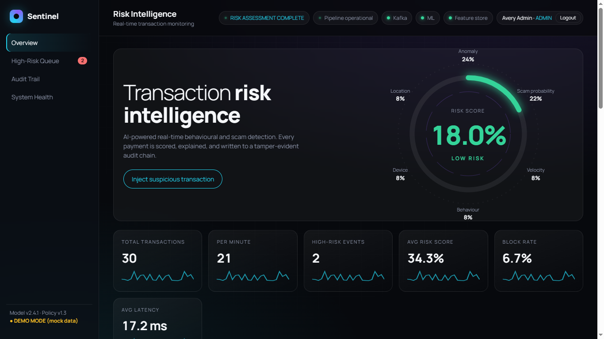
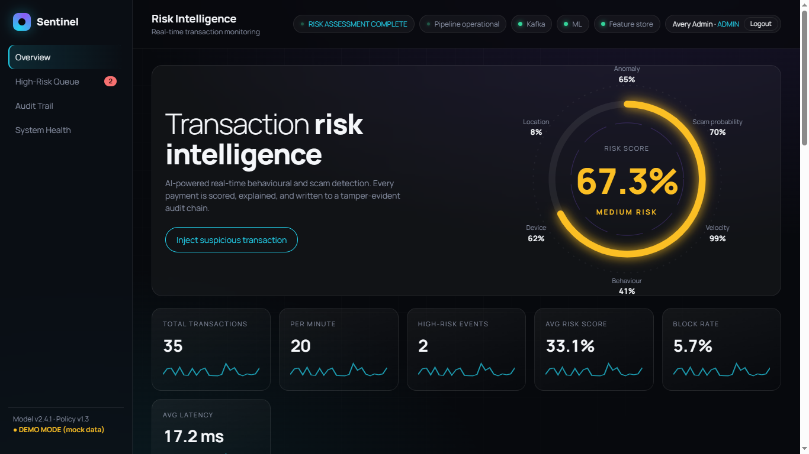
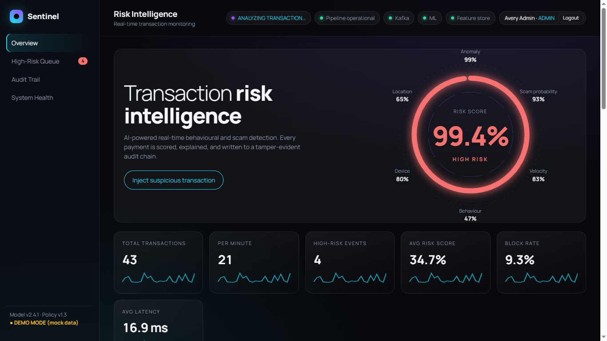
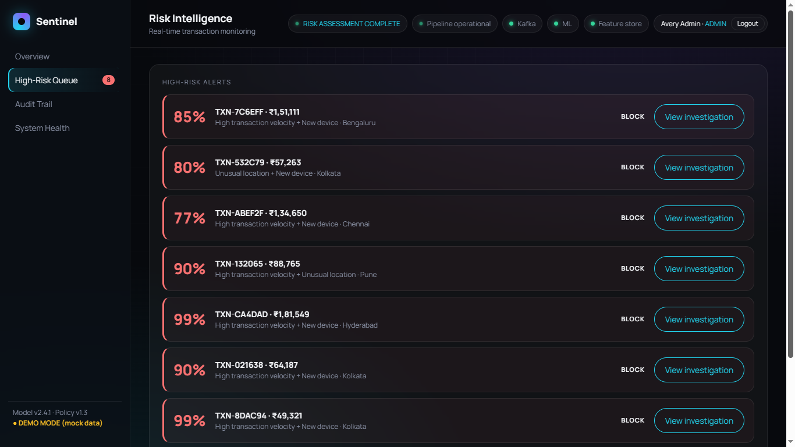
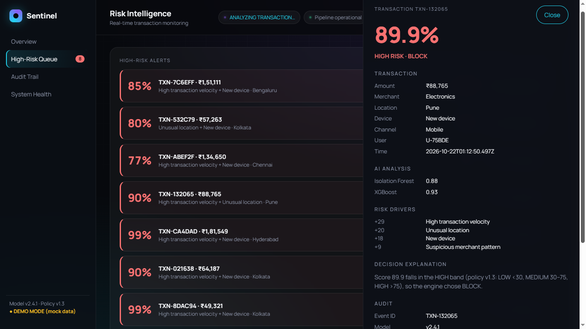
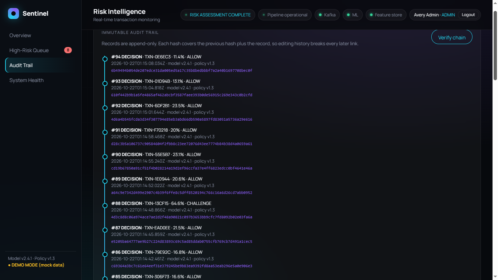

# Sentinel – Screenshots

All screenshots were taken from the running build (dashboard in **DEMO MODE, mock data**).

| # | File | What it shows |
|---|------|---------------|
| 1 | `screenshots/01-landing-hero.png` | Landing page hero with demo risk-engine stats (transactions, high risk, blocked, avg latency) |
| 2 | `screenshots/02-landing-how-it-works.png` | Pipeline strip (Transaction → Feature extraction → Behaviour analysis → AI models → Risk scoring → Policy engine → ALLOW / CHALLENGE / BLOCK / REVIEW) and capability cards |
| 3 | `screenshots/03-landing-cta-footer.png` | Security & audit / Demo-or-live cards, call-to-action and demo-environment footer |
| 4 | `screenshots/04-login.png` | Secure sign-in with the five demo role accounts |
| 5 | `screenshots/05-dashboard-low-risk.png` | Overview – LOW risk gauge with Anomaly / Scam / Location / Device / Velocity / Behaviour breakdown and KPI cards |
| 6 | `screenshots/06-dashboard-medium-risk.png` | Overview – MEDIUM risk transaction |
| 7 | `screenshots/07-dashboard-high-risk.png` | Overview – HIGH risk transaction after "Inject suspicious transaction" |
| 8 | `screenshots/08-high-risk-queue.png` | High-Risk Queue with BLOCK decisions and "View investigation" |
| 9 | `screenshots/09-investigation-drawer.png` | Investigation drawer: transaction, Isolation Forest / XGBoost scores, ranked risk drivers, decision explanation, audit metadata |
| 10 | `screenshots/10-audit-trail.png` | Immutable audit trail – SHA-256 hash chain with "Verify chain" |

## Gallery

